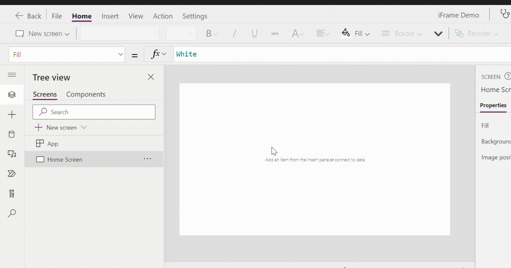

# iFrame PCF Code Component

## Receive text and confirm copying

When the embedded page sends text to the PCF, the control displays a confirmation dialog with the received text. The user must press **Copy text** to write it to the clipboard; **Cancel** dismisses the dialog. Clipboard failures are shown in the dialog.

Clipboard access is performed by the PCF host in response to the user's button click, not by the embedded page. It requires a secure context and can still be restricted by the browser or Power Apps host. CORS is unrelated to clipboard permissions.

Build this variant from this directory with `npm ci && npm run refreshTypes && npm run build`. Its artifacts are isolated in this project's `out` directory.

## Build an importable solution from GitHub Actions

Open the repository's **Actions** tab, choose **Build PCF solution**, select **Run workflow**, and download the artifact named `<repository>-<run number>`. It contains an unmanaged Power Platform solution ZIP that can be imported into an environment. The workflow builds the PCF, packages it with the Power Platform CLI, and does not deploy it.

The workflow keeps the component's manifest and security settings as committed; it does not offer runtime permission overrides. The `src` URL remains configurable on the component in Power Apps.


The **iFrameVirtualPCF** code component provides a wrapper around the `<iframe>` [HTML element](https://developer.mozilla.org/en-US/docs/Web/HTML/Element/iframe#positioning_and_scaling), providing a nested browsing context inside a Power Apps Canvas App or [Custom Page](https://learn.microsoft.com/en-us/power-apps/maker/model-driven-apps/add-page-to-model-app). 

This is a non-standard React ([virtual](https://powerapps.microsoft.com/en-us/blog/virtual-code-components-for-power-apps-using-react-and-fluent-ui-react-platform-libraries/)) code component. 

## Configuration
The control accepts the following properties:
### Properties
- **src** - URL of the webpage to embed
- **FullscreenButton** - sets the visibility of the [Full screen](https://docs.microsoft.com/en-us/power-apps/developer/component-framework/reference/mode/setfullscreen) button. This allows users to expand the iFrame to fit the screen of the host Canvas App (see the demo `.gif` above)
- **noteText** - latest note received from the embedded page
- **noteId** - increments each time a note is received, including when the same text is sent again

## Leaflet notes bridge

Set `src` in the Canvas App to the GitHub Pages URL and append the encoded `data` value once:

```powerfx
"https://cesargarcia-cdcr.github.io/leaflet-Maps/?data=" & EncodeUrl(varEncodedData)
```

Do not include a signed Power Automate URL or other secret in the app source, a public page, or this repository. Values embedded in a Canvas App URL are visible to app users. If a signed URL was exposed, rotate it before using the flow again.

The PCF accepts messages only when both the sending iframe window and its origin match the configured `src`. The current page can continue sending a plain string. To avoid `postMessage(..., "*")` on the page, update `notes.js` to accept the PCF's origin handshake and use that exact origin:

```javascript
let powerAppsOrigin;

window.addEventListener("message", (event) => {
  if (
    event.source !== window.parent ||
    event.data?.type !== "leaflet-notes:init"
  ) {
    return;
  }
  powerAppsOrigin = event.origin;
});

function sendNoteToPowerApps(text) {
  if (!powerAppsOrigin) {
    throw new Error("The Power Apps message bridge is not ready.");
  }
  window.parent.postMessage(
    { type: "leaflet-notes:note", text },
    powerAppsOrigin
  );
}
```

Replace the existing wildcard `postMessage` call in `copyResult()` with `sendNoteToPowerApps(resultText)`. The iframe must be reloaded after the PCF sends its handshake.

The PCF displays its own confirmation dialog when it receives a valid note. It also exposes `noteText` and `noteId` outputs if the Canvas App needs to react to received notes separately.

## Installation / Usage

There are two ways to install the PCF component. 
1. Download the managed solution from the [releases](https://github.com/iamgreggarcia/IFrameVirtualPCF/releases/) page of this repo
2. Clone and push the solution via the [MS Power Platform CLI](https://docs.microsoft.com/en-us/power-platform/developer/cli/introduction)

### Use Power Platform CLI

Make sure you have an [authentication profile](https://docs.microsoft.com/en-us/power-platform/developer/cli/reference/auth#pac-auth-create) configured.

Clone the repo:
```bash
git clone https://github.com/iamgreggarcia/IFrameVirtualPCF.git

cd IFrameVirtualPCF
```
Push the component to your chosen environment:
```bash
pac pcf push --publisher-prefix <your-publisher-prefix>
```

### Add component to a Canvas App



## Limitations
* SharePoint URLs work inside custom pages but ***not*** Canvas Apps. This is because SharePoint (online) restricts cross-site scripting with powerapps.com. Read this helpful tutorial for more info: [SharePoint Document Library In A Power Apps Custom Page](https://www.matthewdevaney.com/sharepoint-document-library-in-a-power-apps-custom-page/)
